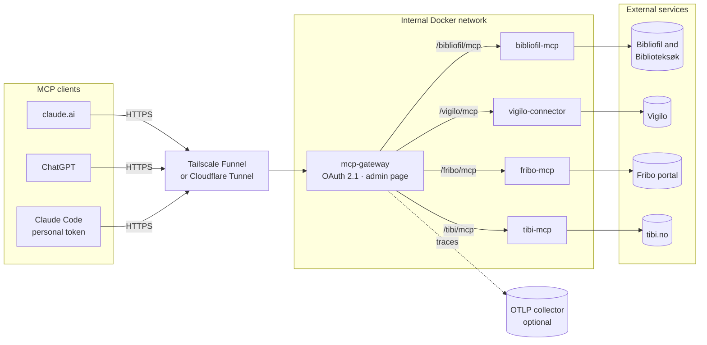
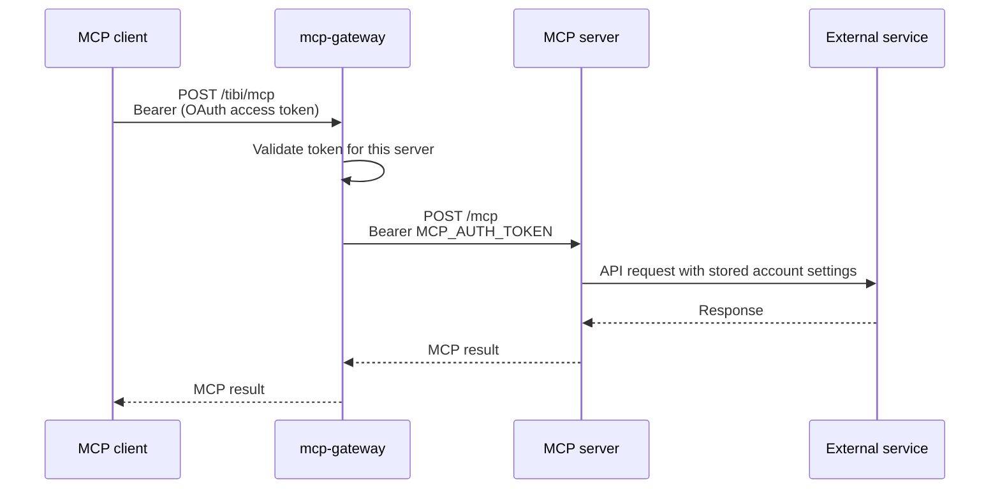
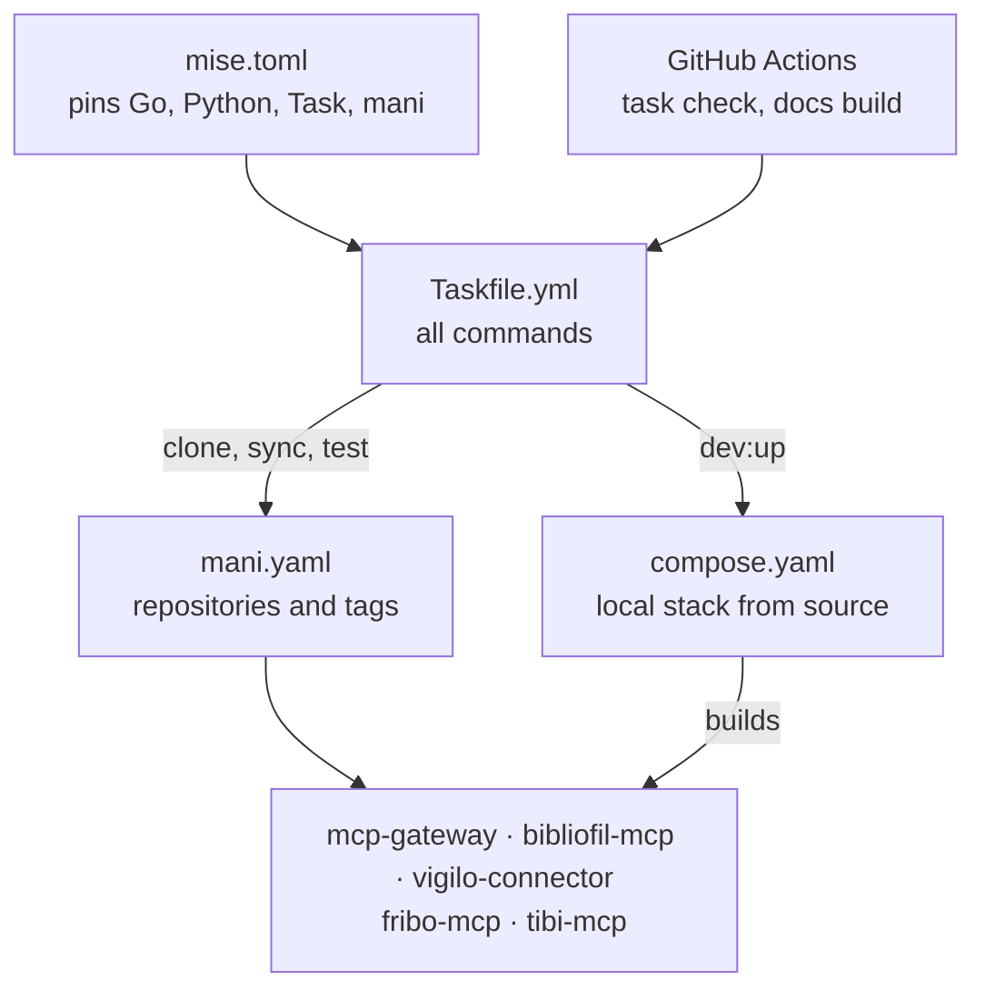

# Architecture

## Runtime

Clients reach every MCP server through mcp-gateway. The servers sit on an
internal Docker network with no public ports, logins or OAuth of their own.

## A tool call

The gateway swaps the client's OAuth token for the server's own token, so
servers never see client credentials.

## The upstream contract

Each server exposes the same endpoints, so the gateway can show a settings
form and a **Test** button for it.

| Endpoint | Auth | Purpose |
|---|---|---|
| `POST /mcp` | Bearer | Streamable HTTP MCP |
| `GET /healthz` | none | Liveness |
| `GET /healthz?check=1` | Bearer | Real checks with current settings |
| `GET /config`, `POST /config` | Bearer | Settings schema and saved values |

Settings are stored in `DATA_DIR` (default `/data`). Environment variables
always win and show as locked in the form.

## Workspace

This repository ties the separate repositories together for development.

The local stack (`task dev:up`) runs as the Compose project
`mcp-workspace-dev`. Only the gateway is published, on
`127.0.0.1:18080`; servers start with `MCP_READ_ONLY=true`.
